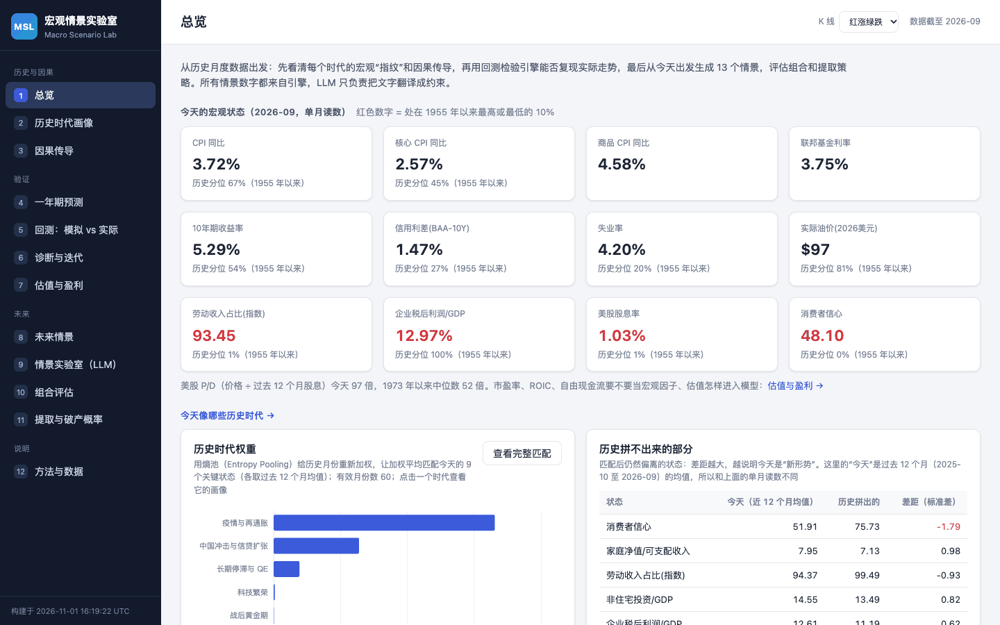
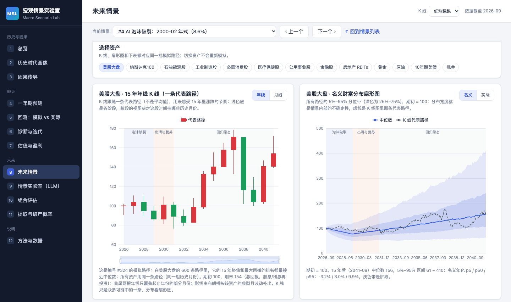
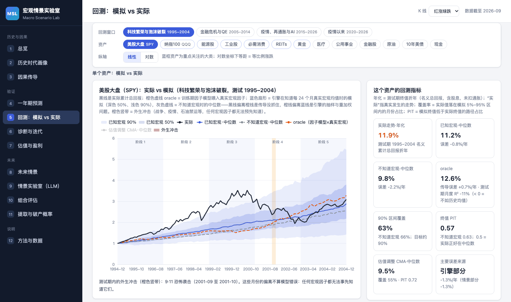
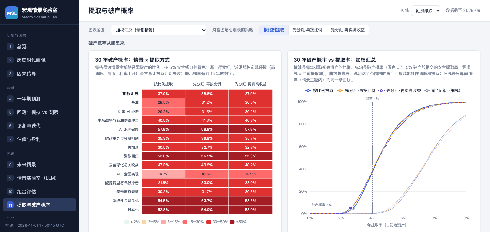

# Causeway · 宏观情景实验室

[](https://github.com/Dongyu-Jia/causeway/actions/workflows/ci.yml)

用美国 1973 年以来真实发生过的历史月份和因果传导，为 13 类大类资产生成“可解释的未来情景”，滚动检验一年期预测，并评估组合在这些情景下的表现与提取（破产）风险。

> **一句话原理**：引擎不“发明”未来。它把历史上真实发生过的每个月当作积木：情景只改变每块 6 个月积木被抽中的概率（Entropy Pooling），历史支撑不够时把视图自动向历史均值收缩；再按今天的利率、油价、估值和股息率把积木重新拼成 15 年的路径。没有情景主题时，只认真预测下一年；多年期结果都以某个情景主题为条件（唯一的例外是提取分析的第 16–40 年，见下文）。LLM 只负责把文字情景翻译成这些约束，**所有数字都由引擎计算**。

*English summary: a local web app (FastAPI + a static ECharts UI, no build step, ECharts vendored so it works offline) on a Python engine. A scenario is a set of phases whose entropy-pooling views reweight 6-month blocks of real US months since 1973; the engine re-anchors the drawn months at today's levels (level-scaled, mean-reverting rates, a real-oil anchor, valuation-adjusted long-run drift, half-coupled residuals) and turns them into 15-year fans and K-lines for 13 asset classes, with every return split additively into its transmission channels. The only unconditional forecast is one year ahead, scored on 42 rolling origins since 1984 and recorded live in an append-only ledger at every build; multi-year results exist only conditional on a scenario theme (13 built-in scenarios, or a narrative that an optional Claude translator turns into views; the LLM never produces numbers). Backtests run on four fixed holdout windows or any window you choose. Portfolio and withdrawal (ruin) analysis runs on the same paths; withdrawal horizons past 15 years (up to 40) continue each scenario path with an unconditional engine path, and the page labels this. Every historical month since 1948 and every simulated path carries one of six macro regimes (expansion, inflation, falling prices, recession, deep recession, stagflation), classified by one rule from CPI y/y and the direction and depth of industrial production confirmed by unemployment; scenario phases can ask for regime months, every scenario reports its regime mix next to the engine's unconditional run, and regimes stay out of the transmission model and the one-year forecast because both out-of-sample tests failed. The UI is in Simplified Chinese.*

<table>
  <tr>
    <td width="50%"><a href="docs/screenshots/overview.png"></a><br><sub>总览：今天的宏观状态，以及它最像哪些历史时代</sub></td>
    <td width="50%"><a href="docs/screenshots/scenarios.png"></a><br><sub>未来情景：代表路径的年线 K 线（默认红涨绿跌）和财富扇形图</sub></td>
  </tr>
  <tr>
    <td width="50%"><a href="docs/screenshots/backtest.png"></a><br><sub>回测：已知宏观时的模拟扇形图 vs 实际走势</sub></td>
    <td width="50%"><a href="docs/screenshots/withdrawal.png"></a><br><sub>提取与破产概率：30 年里情景 × 提取方式的破产概率、破产概率随提取率的变化</sub></td>
  </tr>
</table>

## 功能

| 分组 | 页面 | 内容 |
|---|---|---|
| 历史与因果 | 总览 | 今天的宏观状态、它像哪些历史时代（熵池拟合，以及历史拼不出来的部分）、情景概率一览、下一年的回报分布 |
| | 历史时代画像 | 9 个时代（1955–今）：宏观指纹、资产实际回报、时代内相关性、股债相关、油价→通胀传导、菲利普斯曲线；今天在历史上的位置，收入分配的新形势；**传导归因**：1973 年以来每个时代的资产回报拆成 β × 当时的实际因子变动、常数项、未解释部分和收入（热力图） |
| | 宏观体制 | 每个月归入扩张、通胀、物价负增长、衰退、深度衰退、滞胀之一（只用 CPI 同比、工业产出的方向和跌幅、失业率三条序列；常说的“通缩”和“萧条”分别对应物价负增长和深度衰退）：今天的实时体制和离每道门槛还有多远、1948 年以来的时间线、和 NBER 衰退日期的对比（样本内和样本外）、各体制下的资产表现和收缩期的逐段路径、宏观特征、体制转换、体制之后一年的回报（带发布滞后和置换检验）、引擎里的体制、为什么体制不进入一年期预测和传导模型 |
| | 因果传导 | 符号约束 SVAR：石油供给 / 总需求 / 货币政策 / 金融冲击的分时期脉冲响应、通胀的历史分解；劳动收入占比冲击的季度局部投影；因子→资产 β 随时期的变化；从冲击到资产的因果链 |
| 验证 | 一年期预测 | 从今天出发的未来 12 个月分布（无条件、相似起点、情景加权）；1984 年以来 42 个起点（每年年末，加上最近一个已有完整下一年的月份）的滚动成绩单：90% 区间覆盖率、CRPS、PIT、跨资产排序 IC，外生冲击年份单独标出，偏离最大的预测逐个归因；**实时样本外记录**：每次构建把当时的一年期预测原样存档（只追加、不覆盖），到期后用新数据评分；**情景概率与一年期预测的对账**：情景加权的第一年为什么比相似起点法悲观，差距按情景拆开 |
| | 回测：模拟 vs 实际 | 4 个保留窗口：实际走势、oracle（训练期传导 × 真实因子）、已知宏观的条件扇形图、不知道宏观的无条件中位数；误差拆成情景 / 引擎 / 传导三部分；后验相关性；引擎抽中了哪些历史月份；外生冲击在图上标出；**自选回测窗口**：任选训练期截止月份（最早 1987-12）和 1–15 年的测试期，结果可以用链接分享 |
| | 诊断与迭代 | 预测为什么不准：缺因子、缺传导机制、要调参、要神经网络？走步迭代：诊断 → 改进 → 在未触碰的时段上检验（增量关卡：第 2 轮的改动要胜过本轮起始模型）；只作用于单个资产的专门改动；**缺失因子审计**：六个研究家族测过的候选、多重检验与反驳检验、每项改动的证据和注意事项、能解释多少、按资产和按概念的缺口；引擎消融的结果（可选） |
| | 估值与盈利 | 标普 500 / 纳指的市盈率、ROIC、自由现金流要不要当宏观因子：今天的 P/D 与公允值、公允值回归与稳定性、拉力速度 κ、估值状态变体的回测、外生候选因子、各情景隐含的 15 年后 P/D |
| 未来 | 未来情景 | 13 个内置情景按后验概率排序：因果链、分阶段视图与抽中的历史月份、**宏观体制**（每个阶段的模拟路径、抽中月份和引擎无条件抽样各是什么体制，第 1 年出现收缩的路径占比对照历史基准）、月线 / 年线 K 线、名义与实际扇形图、宏观路径（含 P/D）、后验相关性、收入分配计算器、校验报告；跨情景对比；**传导归因**：每个阶段、每类资产的年化回报来自哪些因子（瀑布图，因果链的连线上标出引擎算出的数字） |
| | 情景实验室（LLM） | 输入一段文字叙事 → 本机 Claude Code（使用你的订阅额度）翻译成情景规格（可编辑的 JSON，阶段可以用 regime 字段要求多抽某种宏观体制的历史月份，并检查历史上能不能做到）→ 校验截断 → 引擎模拟并保存；不调用 LLM 也能“载入示例”（内置情景的叙事和手写规格，看一遍完整流程），或载入内置情景当模板、编辑后运行 |
| | 组合评估 | 任意 13 类资产权重和再平衡方式：每个情景及概率加权 / 等权 / 最差 / 最好情景下的 CAGR、波动、夏普、Sortino、最大回撤、CVaR；可以调整情景概率、纳入自定义情景；**情景概率校准**：概率可选模型后验、按一年期预测校准或手动（校准只用通过检验的宏观变量，目前没有变量通过，这个选项暂时不可用） |
| | 提取与破产概率 | 三种提取方式：按比例、先用股息再按比例、先用股息再按当年收益从高到低卖；破产概率、存活曲线、安全提取率、期末实际财富；**30 年提取**：期限 10–40 年（默认 30 年），前 15 年是情景路径，第 16 年起按历史月份无条件续抽，15 年与所选期限的结果并列 |
| 说明 | 方法与数据 | 引擎每一步怎么做、当前的估值锚定参数、数据来源与局限 |

资产（大类）：美股大盘、纳斯达克100、石油能源股、工业制造股、必需消费股、医疗保健股、公用事业股、金融股、房地产 REITs、黄金、原油、10 年期美债、现金。K 线默认红涨绿跌，可以在页面右上角切换为绿涨红跌。

## 快速开始

需要 Python 3.10 或更新的版本。

```bash
git clone https://github.com/Dongyu-Jia/causeway.git
cd causeway
python3 -m venv .venv && source .venv/bin/activate      # Windows：.venv\Scripts\activate
pip install -e ".[llm,dev]"
python -m scenariolab.build      # 首次运行先下载公开数据（无需任何 key），再估计模型、跑检验和情景
python -m scenariolab.server     # 打开 http://127.0.0.1:8765
```

- 首次构建要下载约 85 个文件（约 65 个 FRED 序列、3 个 Ken French 压缩包，Nareit、金价、席勒 CAPE 各一个，以及美联储 GZ 信用利差、纽约联储 ACM 期限溢价、世界银行 Pink Sheet、房价、地缘政治风险、政策不确定性和中性利率的出版方文件）。FRED 偶尔限流，下载失败时重新运行同一条命令即可：已经下载的文件会直接复用，只有 `--refresh` 才会重新下载。
- FRED 的 API key 是可选的（免费注册）：在 `.env` 里填 `FRED_API_KEY=…`，构建就通过 `api.stlouisfed.org` 下载（更稳定），没有它就用 FRED 的图表 CSV，结果相同。key 被拒绝或 API 暂时不可用时，构建自动改用不带 key 的图表 CSV。key 只发给 `api.stlouisfed.org`，日志和记录里的网址一律写成 `api_key=REDACTED`。已经有研究轮下载的文件时，可以先用 `python -m scenariolab.data.import_raw <目录> [--force]` 把它们导入 `data/raw/`（只复制字节并核对哈希，写出 `data/raw/SOURCES.json` 和 `import_log.json`），不必重新下载。
- 席勒 CAPE（[ie_data.xls](http://www.econ.yale.edu/~shiller/data/ie_data.xls)）是可选来源：下载失败时各页面上的 CAPE 为空，构建照常完成，回测、一年期预测和情景的结果不受影响，下一次构建会再试一次。也可以手动把它放到 `data/raw/shiller/ie_data.xls`。
- 构建时间：不算首次下载数据，默认构建约 5 分钟，最慢的一步是估值检验 valuation（约 2.7 分钟），宏观体制 regimes 约 40 秒，缺失因子审计 factor_audit 约 20 秒；连同两个默认不跑的步骤（`--all`：引擎消融约 5 分钟、宏观体制的一年期预测检验约 2 分钟）约 12 分钟，峰值内存约 2.8 GB（引擎消融；其余步骤最多约 2.3 GB）。结果写进 `data/results/`，网页直接读取这些文件；一年期预测另外存档到 `data/ledger/`（见下文“实时样本外记录”）。
- 常用参数：
  - `--refresh`：重新下载全部数据（包括席勒 CAPE）。
  - `--skip panel`：不重建数据面板，用已缓存的面板重建全部结果。
  - `--only <步骤…>`：只跑部分步骤（panel quarterly causality eras diagnostics factor_audit backtest scenarios regimes forecast valuation portfolio llm qmodel meta ablation regime_forecast evaluation，总是按这个顺序执行）。季度模型（试运行）的三步：quarterly 由月度面板和季度导入缓存的原始文件生成季度面板（约 2 秒，从不下载），qmodel 拟合因子层并把 T-F、T-C 写进 data/results/qmodel.json（约 2 分钟，要先有 diagnostics 的结果），evaluation（可选，不默认运行）检查预注册记录的完整性、输入是否与冻结时相同，并复现输入相同的记录；缺少季度输入时这三步跳过并说明缺什么，不算失败。缺失因子审计 factor_audit 是默认步骤（约 20 秒），要先有 diagnostics 的结果；单独重建用 `--only factor_audit`。时代画像 eras 用走步检验选中的模型做传导归因：同一次构建里 diagnostics 换了模型（例如新克隆的第一次构建）时，eras 会在 diagnostics 之后自动重做；只跑 `--only diagnostics` 时构建会提示补跑 `--only eras`。改了 `scenariolab/scenarios/specs/*.yaml` 之后运行 `python -m scenariolab.build --only scenarios regimes forecast valuation portfolio llm`：宏观体制页和情景的体制读数共用同一次引擎无条件抽样，一年期预测、估值页、组合默认值和 LLM 示例都依赖情景结果或情景文件。
  - `--paths 1000`：每个内置情景的模拟路径数（默认 600）。
  - `--all`：连同默认不跑的引擎消融（ablation，约 5 分钟）和宏观体制的一年期预测检验（regime_forecast，约 2 分钟）一起跑；也可以单独运行 `--only ablation` 或 `--only regime_forecast`。
- 重新构建之后重启服务器：自定义情景、自选回测窗口和 LLM 翻译用的是服务器启动时载入的引擎。换端口：`MSL_PORT=9000 python -m scenariolab.server`。
- 页面的图表库 [Apache ECharts](https://echarts.apache.org) 5.5.1 随代码放在 `web/vendor/echarts/`（Apache License 2.0，许可证和 NOTICE 在同一目录），不依赖 CDN，断网也能打开；页面只访问本机的服务器。
- 测试：`pytest -q`（写作时共 558 个测试，完整构建之后约 4 分钟；测试从不启动真正的 Claude Code，也不消耗订阅用量；需要数据或结果文件的测试在构建之前会自动跳过，默认构建之后只剩引擎消融的 1 个测试跳过，跑过 `--only ablation` 才会执行）。GitHub Actions 在 Python 3.10 和 3.12 上对每次推送和 PR 运行编译检查、`ruff check scenariolab tests` 和全部测试（只装 dev 依赖，不装 llm 扩展，翻译器的测试文件整体跳过；新克隆没有数据，依赖数据的测试跳过：352 个通过、178 个跳过；装了 llm 扩展时 357 个通过、201 个跳过）。
- 想参与开发、添加情景或数据源：见 [CONTRIBUTING.md](CONTRIBUTING.md)。

### LLM 情景实验室：本机 Claude Code（使用你的订阅额度）

翻译默认交给本机的 Claude Code 命令行（`claude -p`，非交互模式），用的是你自己的 Claude 订阅登录（例如 Max），不需要 API key，也不按 API 计费。

1. 安装 Claude Code，在终端运行 `claude auth login`，用你自己的 Claude 订阅账号登录（`claude auth status` 可以确认）。也可以运行 `claude setup-token`，把生成的令牌写进 `.env` 的 `CLAUDE_CODE_OAUTH_TOKEN=`：整个令牌写在一行里（终端把它折成两行时要先合并），然后重启服务。
2. 可选：`cp .env.example .env`。`MSL_LLM_BACKEND=claude_code` 是默认值；`claude` 不在 PATH 里时用 `MSL_CLAUDE_BIN` 写它的完整路径（否则依次找 PATH 和 `~/.local/bin/claude`）；`MSL_LLM_MODEL` 换模型（默认 `claude-opus-5-5`）；`MSL_LLM_TIMEOUT` 是每次翻译最多等多少秒（默认 600），`MSL_LLM_CONCURRENCY` 是同时最多几次调用（默认 2）。
3. 打开情景实验室：状态栏写着“本机 Claude Code（使用你的订阅额度）”和登录方式（Claude Code 登录 / CLAUDE_CODE_OAUTH_TOKEN / 未登录）；未登录时按提示运行 `claude auth login` 后刷新页面即可，不用重启服务。

- **用量**：每次翻译都计入你订阅的 5 小时和每周用量上限。查询状态只运行 `claude --version` 和 `claude auth status --json`，不消耗用量；构建（`python -m scenariolab.build`）从不调用模型。同一段叙事（同一后端、模型和提示词）的翻译结果缓存在 `data/llm_cache/`（只存模型回答的文本和用时、轮数、token 数，不存提示词、叙事或凭据），再翻译一次直接读缓存、不消耗额度；要重新翻译，在实验室里点翻译结果旁边的“重新翻译”，命令行加 `--refresh`，或在 `POST /api/llm/translate` 的请求体里加 `"refresh": true`。
- **隔离**：Claude Code 在一个空的临时目录里运行，不给它任何工具（`--tools ""`），不加载 MCP 服务器、用户设置、钩子和 CLAUDE.md，也不保存会话；它的环境里去掉了所有 `ANTHROPIC_*` 变量（`ANTHROPIC_API_KEY` 或 `ANTHROPIC_AUTH_TOKEN` 在非交互模式下总是优先，会改成按 API 计费）、上层 Claude Code 会话的 `CLAUDE*` 变量和其他名字像凭据的变量（`…_API_KEY`、`…_TOKEN`、`…_SECRET`、`…_PASSWORD`，例如 `.env` 里的 `FRED_API_KEY`），只保留 `CLAUDE_CONFIG_DIR` 和非空的 `CLAUDE_CODE_OAUTH_TOKEN`。
- **只供个人在本机使用**：服务只监听 127.0.0.1，翻译接口只接受 Host 是 127.0.0.1 或 localhost 的请求（别的网站把自己的域名解析到 127.0.0.1，也就是 DNS rebinding，会得到 403，用不了你的订阅额度）；每个人用自己电脑上、自己登录的 Claude Code。程序不替别人转发请求，也不保存或转发任何人的凭据。不要把它部署成给别人用的服务。
- 想改用 Anthropic API（按 API 计费）：在 `.env` 里写 `MSL_LLM_BACKEND=api` 和 `ANTHROPIC_API_KEY=…`，安装可选依赖 `pip install -e ".[llm]"`，再重启服务。只有明确设置 `MSL_LLM_BACKEND=api` 时才会用 API。

不调用 LLM 时其余功能全部照常可用；实验室的“载入示例”会把一个内置情景的叙事和它手写的规格（按 LLM 的输出格式排列，标明不是实时翻译）分别放进第 ① ② 步，可以直接交给引擎运行，看一遍“叙事 → 规格 → 引擎”的完整流程；也可以载入内置情景当模板、编辑规格后运行，只是不能把自己的文字翻译成规格。**`.env` 已经写进 `.gitignore`，永远不要提交它。** 命令行也可以翻译：`python -m scenariolab.llm.translator "霍尔木兹海峡被封锁半年……" --run`（`--refresh` 不用缓存）。

## 工作原理

```
公开数据（FRED / Ken French / Nareit / 金价 / 席勒 CAPE / 美联储 GZ / 纽约联储 ACM / 世界银行 Pink Sheet 等）→ 月度面板 1947–今（模型样本从 1973 年开始）
   │
   ├─ 因果识别：符号约束 SVAR → 结构冲击 e_*；分时期脉冲响应；劳动收入占比的局部投影
   ├─ 传导模型：资产价格回报 ~ 同月 11 个因子的变化（线性）：9 个核心因子 + GZ 信用利差 + 高核心通胀时的
   │   期限溢价变化；能源股另含基础金属相对油价，黄金方程从 1982 年起估计。走步迭代比较了加因子、滞后、
   │   通胀状态、岭回归、神经网络，每一轮选出的改动要作为一组在未触碰的测试期胜过本轮起始模型才保留（见“缺失因子审计”）
   │
   ├─ 宏观体制：每个月按 CPI 同比、工业产出的方向（失业率确认）和跌幅贴标签（1948 年起），历史月份和模拟路径用同一套规则
   │
情景 spec（13 个内置 YAML，或 LLM 从文字翻译）：分阶段视图（可含宏观体制占比）+ 有上限的覆盖项 + 因果链（+ 收入分配计算器）
   │  validate_spec：只允许引擎支持的变量；目标截断到“该阶段 6 个月均值”的历史 2%–98% 分位；阶段补齐 / 截短到 180 个月
   ▼
每个阶段：在 6 个月区块的起点上做 Entropy Pooling，抽中月份的均值在期望上正好等于视图
   │  历史支撑太薄（不到 30 个有效月份或不到 6 段不同的历史）→ 全部视图按同一个 λ 向历史均值收缩并报告
   │  confidence < 1 → 向无条件历史混合；2020 年 3–8 月封锁月份的先验权重 × 0.25
   ▼
加权块状抽样（6 个月一块）→ 从今天的水平重新拼接
   │  利率变化按“今天 ÷ 当时”的水平缩放（最多放大 1.5 倍）并温和均值回归；信用利差、失业率回归固定水平
   │  实际油价回归 1973 年以来的中位数（按今天的价格约 68 美元），对油价设了视图或漂移的阶段除外
   ▼
资产 = 今天的传导系数 × 模拟的因子变化 + 历史残差（一半跟着抽中的月份，一半独立抽取）
       + 估值调整的长期漂移（今天的 P/D 15 年内向历史中位数回归 30%）+ 有上限的覆盖项
       10 年期美债按收益率重定价，现金跟随政策利率，原油取油价变化；每条路径记录 P/D（κ = 0，只记录）
   ▼
每个情景 600 条 × 180 个月 → 扇形图、代表路径 K 线（月线 / 年线）、宏观路径、后验相关性、每条路径的宏观体制
   → 情景概率（主观先验 × 与今天的相似度^0.5）→ 组合评估、提取与破产概率

检验：一年期滚动预测（1984 年起，每次只用当时的数据）· 回测窗口（把真实宏观路径当作情景主题）· 引擎消融 · 估值检验
```

更多细节见 [docs/ARCHITECTURE.md](docs/ARCHITECTURE.md)（模块契约、构建步骤、JSON 格式、API）和网页里的“方法与数据”页。

### 传导归因：回报从哪里来

情景页和时代页把每类资产的年化回报拆成可以相加的几块（单位 %/年 = 每月算术回报的均值 × 12）：β × 模拟的因子变动（油价、利率、通胀、美元……，用的是经过水平缩放、均值回归和油价锚定之后的变动）、常数项（因子不变时模型给出的回报，每个情景都一样，例如美股大盘 +8.2%/年）、估值调整、情景覆盖、未解释部分（残差）和收入；最后一步“复利、波动与中位数修正”把算术合计换算成页面上的中位数年化回报（它包括路径中位数与均值之差，所以在短而偏斜的阶段可以是正数）。股票、REITs 和黄金的常数项、估值调整和收入在每个情景里都一样，情景之间的差别只来自因子项、覆盖项和未解释部分；10 年期美债、现金和原油按收益率、政策利率和油价路径结构化生成，分别归到利率、收入和油价。

例如“中东战争与石油供给冲击”的前 6 个月（冲击期），石油能源股每年约 +21.0% 来自油价、−4.1% 来自基础金属相对油价（能源股的专门因子）、+3.5% 来自服务通胀、+2.3% 来自失业率，因子合计 +21.1%；再加常数项 +5.8%、估值调整 −3.3%、未解释部分 −8.6% 和收入 +2.8%，算术年化 +17.7%，修正 +0.7% 之后是中位数年化 +18.4%。因果链里从因子指向资产的连线（例如“油价 → 能源股”）也标出引擎算出的这个数字。时代页用同样的拆法看历史：大通胀时期（1973–1982）美股大盘的价格回报每年 +4.7% = 因子 −2.4% + 常数项 +8.2% + 未解释部分 −1.1%，因子在这个时代里只解释了月度价格波动的 19%。

### 宏观体制：通胀、衰退、滞胀……怎么判定，进不进模型

有没有宏观因子能代表某个阶段是通胀、通缩、滞胀还是萧条？有，三条序列就够了，而且模拟器本身就生成这三条序列，所以历史月份和每条模拟路径可以用同一套规则贴标签（`scenariolab/engine/regimes.py`，参数都在 `config.REGIMES`）：

- **通胀轴：CPI 同比。** 高于 4% 是高通胀，低于 0 是物价负增长。
- **增长轴：工业产出的方向，用失业率确认。** 工业产出从高点下跌 3%、同时失业率（3 个月均值）比这一段的低点上升 0.5 个百分点，就是收缩。
- **深度：本轮工业产出从高点的累计跌幅。** 跌到 15% 或更多是深度收缩。

六种体制按顺序取第一个成立的：**滞胀**（收缩，且这段收缩期间平均 CPI 同比高于 4%）、**深度衰退**（深度收缩）、**衰退**（其余收缩）、**物价负增长**（没有收缩且 CPI 同比低于 0）、**通胀**（没有收缩且高通胀）、**扩张**（其余）。“通缩”和“萧条”这两个词在数据里分别对应物价负增长和深度衰退，因为 1948 年以来的美国数据里既没有萧条，也没有债务型通缩：最深的两次收缩是 2008–09 年（工业产出 −17.2%）和 2020 年（−18.8%），没有收缩而 CPI 同比为负的 28 个月是衰退之后的复苏期或油价暴跌后的基数效应。滞胀有 5 段（1970、1973–75、1980、1981–82、1990–91）。事后版标签对 NBER 衰退日期的平衡准确率是 0.960（12 次衰退全部检出；参数是对着这些日期选的，逐次留出一次衰退的样本外为 0.909–0.933），只用当时数据的实时版平均晚 3.9 个月亮。今天（2026-09）的实时体制是扩张，CPI 同比离 4% 线还差 0.28 个百分点。

进入模型的部分：每个历史月份和每条模拟路径的标签；情景的每个阶段可以用 `regime` 字段要求多抽某种体制的历史月份（熵池化里的普通视图，历史支撑不够时给出警告，例如衰退在 1973 年以来只有 2001 年一段）；每个情景都附有体制读数，和引擎自己的无条件抽样、历史基准并排。内置情景的阶段名称写到的体制（滞胀、衰退、通胀）在模拟路径里都占这一阶段一半以上的月份：滞胀回归在半年的沃尔克式紧缩之后接一年的滞胀式衰退（多抽滞胀月份），中东战争的一年衰退期多抽收缩月份、不抽深度衰退的月份，之后接一个复苏阶段，绿色通胀的 CPI 目标在 4% 线以上；要求多抽收缩月份的阶段还要看模拟出来的收缩有多长（体制读数逐阶段列出长于 18 个月的收缩，并和引擎无条件抽样同一时段对照），两个阶段与之重叠的收缩里长于 18 个月的占比都在对照的 10 个百分点以内（滞胀式衰退 37% 对 35%，中东战争的衰退期 16% 对 20%；1973 年以来的 7 次收缩没有一次长于 18 个月）；历史撑不起来的就改名或在叙事里写明实际的体制构成（日本化：1973 年以来没有持续的物价下跌，所以写低通胀和低利率，不写通缩）。**没有进入模型的部分**，因为样本外检验没有通过：

- **传导模型不按通胀状态拆分系数。** 诊断的走步检验里，全部系数按上月高通胀拆分，样本外 R² 在三个十年里变化 −0.057 / −0.008 / −0.104，没有通过；走步检验只保留了一项：上月核心 CPI 同比高于 4% 时，期限溢价变化单独进入传导模型（见下文“是不是少了因子？”）。宏观体制的高通胀看当月 CPI 同比；传导模型的期限溢价项看上月核心 CPI 同比；门槛都是 4%。
- **一年期预测不用体制。** 6 类做法（把实时体制指标加进相似起点、按同一体制加权、只从同一体制抽）在 42 个起点、5 组随机种子上检验（`--only regime_forecast`），没有一类在 5 组种子里都同时在 2004 年前后两半好于现行预测（最多的一类只在 1 组种子里两半都更好）。

还要注意：引擎无条件模拟里 CPI 同比高于 4% 的月份占 41%（1973 年以来的历史为 33%），所以模拟路径里“通胀”的占比系统性偏高，情景页的体制读数总是附上这条说明和同一时段的引擎无条件对照。

## 验证结果

下面的数字来自 2026-11-02 的构建（`meta.json` 的 built_at 为 2026-11-02T06:20:04Z，数据截至 2026-09），重新构建后会变；网页上的对应页面总是显示当前结果。风险资产 = 股票、REITs、黄金。

### 多年期：只在给定情景主题时检验（回测：模拟 vs 实际）

模型、历史月份库和起点都只用训练期的数据；条件扇形图把测试期每 24 个月的真实宏观均值（8 个变量）当作“情景主题”，检验“如果事先知道宏观路径，引擎能不能算对资产”。

| 窗口 | 测试期 | 已知宏观时的年化误差 | 不知道宏观 | 90% 区间覆盖率（已知 / 不知道） |
|---|---|---|---|---|
| 科技繁荣与泡沫破裂 | 1995-01 至 2004-12 | 3.5% | 3.8% | 78% / 81% |
| 金融危机与 QE | 2005-01 至 2014-12 | 3.4% | 2.9% | 88% / 89% |
| 疫情、再通胀与 AI | 2015-01 至 2026-09 | 4.0% | 3.6% | 100% / 98% |
| 疫情以来 | 2020-01 至 2026-09 | 5.8% | 5.6% | 96% / 96% |
| 4 个窗口平均 | | 4.1% | 4.0% | 91% / 91% |

- 年化误差 = 风险资产模拟中位数年化收益与实际之差的绝对值平均。知道宏观之后剩下的误差里，传导部分（因子模型解释不了的）平均每年 4.0%，引擎部分（抽样、重加权、再锚定）1.3%。
- 宏观因子在样本内解释风险资产月度价格波动的 23%，扩展窗口的样本外只有 15%：模拟 K 线的大部分波动来自重抽样的真实历史残差，因子决定的是条件分布的位置。
- 4 个窗口中有 3 个“知道宏观”反而误差更大，原因见下面的引擎消融。

### 一年期滚动预测（一年期预测）

1984-12 至 2025-09 的 42 个起点，每次只用当时的数据重新估计模型、预测下一年。相似起点法按“今天像哪些历史起点”给历史年份加权；无条件法随机抽一个历史年份（两者用同一组随机数，差别只来自权重）；朴素基准是训练期 12 个月收益的正态分布。

| 风险资产平均 | 相似起点 | 无条件 | 朴素基准 |
|---|---|---|---|
| 90% 区间覆盖率（理想值 90%） | 87.6% | 91.0% | 90.7% |
| 剔除 6 个外生冲击年份后 | 87.8% | 91.9% | 92.2% |
| CRPS（越小越好） | 0.1105 | 0.1097 | 0.1112 |
| 跨资产排序 IC（t 值） | 0.14（2.2） | 0.20（3.4） | −0.01（−0.3） |

- CRPS 技能：相似起点与无条件抽样差不多（技能 −0.6%，t −0.5），与朴素基准差不多（+0.6%，t 0.2）；剔除外生冲击年份后分别为 −1.2% 和 −2.3%（t −0.9 和 −0.7），都在随机误差之内。按“今天像哪段历史”加权，在一年期里还没有带来可验证的改进。
- 超额收益方向的命中率 71%，正好等于同期上涨年份的占比 71%：方向判断不比“总是猜涨”更好，有价值的是可靠的区间和跨资产排序。
- 偏离最大的 15 次预测中，2 次（13%）发生在外生冲击年份，13 次是宏观意外（实际的宏观变化落在预测的 90% 区间之外，例如 2007 年底之后的衰退和急速降息），没有一次是宏观符合预期而资产本身偏离（估值或盈利）。
- “像哪段历史”该押多重是在 2004 年及以前的起点上选出的，之后的起点只用来检验。候选是每个起点可用历史起点数的 1/32、1/16、1/8、1/4、1/2（最多一半，每个起点都够用），选中最平的 1/2（第一个起点约 66 个有效起点，今天约 316 个）；42 个起点的权重都不是平的。押得越集中区间越窄、越容易被现实打穿：1/32 时检验期覆盖率只有 80%。

### 实时样本外记录、情景概率的对账与校准（一年期预测）

- **实时样本外记录**：上面的成绩单是事后回放（每个起点只用当时的数据，但模型和代码是今天的）。每次构建还会把当时的一年期预测原样存进 `data/ledger/forecast_<起点>.json`：每个起点一个文件，只追加、不覆盖，不补记更早的起点，起点之后 3 个月以上才做的预测也不记；数据更新到起点之后 12 个月时，下一次构建自动给它打分（覆盖率、PIT、CRPS）。目前有 1 条记录（起点 2026-09），要等数据更新到 2027-09 才能评分。`data/` 不进 git，账本留在各自的电脑上。
- **对账**：同一个起点、同一套引擎，情景加权的第一年比相似起点法悲观：美股大盘中位数 +4.1% 对 +8.1%，P(亏损) 41% 对 28%。差距来自把冲击放在第一年的 7 个情景（系统性金融危机、AI 泡沫破裂、去全球化、中东战争、日本化、滞胀、K 型 AI 经济，合计概率 48%）：按概率加权，它们第一年的失业率平均上升 0.63 pp，相似起点法是 −0.01 pp。页面把均值和 P(亏损) 的差距逐个情景拆开，各项相加正好等于差距。
- **校准**：情景概率只向“有预测能力”的宏观变量对齐：相似起点法对这个变量 12 个月变化的预测，要同时胜过无条件抽样和历史均值基准（全部 42 个起点、2004 年前后两半的 CRPS 都更低，配对 t ≥ 1）。目前没有变量通过：CPI 同比胜过无条件抽样（CRPS 技能 +32.0%，t = 5.5），却只和历史均值基准持平（0.0%，t = 0.0）；失业率和政策利率胜过历史均值基准（+15.4%、+15.5%），却不胜过无条件抽样；信用利差和油价两者都不胜过。所以组合评估和提取页的“按一年期预测校准”暂时不可用，默认仍是模型后验概率。

### 提取：30 年的破产概率

60/40（美股大盘 60% + 10 年期美债 40%），每年提取初始资产的 4% 并随通胀上调，按情景概率加权。前 15 年是各情景自己的路径；第 16 年起没有情景主题，每条情景路径各接一条独立的无条件引擎路径（共 7800 条，长期回报假设去掉了只为前 15 年设定的估值回归项）。

| | 按比例提取 | 先用股息/利息，不足按比例 | 先用股息，不足按当年收益从高到低卖 |
|---|---|---|---|
| 破产概率：15 / 30 / 40 年 | 0.065% / 37.6% / 57.7% | 0.29% / 38.8% / 57.4% | 0.46% / 38.3% / 56.1% |
| 安全提取率（破产概率 ≤ 5%）：15 / 30 / 40 年 | 5.19% / 2.69% / 2.12% | 5.07% / 2.55% / 1.98% | 4.96% / 2.54% / 1.96% |

- 30 年里破产概率最高的情景是 AI 泡沫破裂（按比例提取 61.8%），最低的是 AGI 全面实现（21.0%）。
- 这远高于“4% 规则”通常引用的约 5% 的历史失败率，但不是续抽方法造成的：同一套提取代码放在真实历史上（1953 年以来每个月份起点的 30 年窗口）失败约 6–7%，最差的起点是 1968-11（最低可持续提取率 3.75%）。差距来自引擎的长期回报假设：今天美股的股息率只有 1.1%（1953 年以来平均 2.8%），不假设 1973 年以来每年 +1.71% 的估值抬升会重演，前 15 年 P/D 还向历史中位数回归（每年 −1.27%）。结论取决于这些估值假设，使用前请自己判断。

### 引擎消融：残差怎么跟着抽中的月份走（引擎用 50% 部分耦合）

为什么“知道真实宏观路径”反而让回测更差？引擎消融（`--only ablation`，5 个随机种子）比较了 20 个变体（含基准引擎）：在 1995–2014 年的两个验证窗口上选，在 2015 年以来的两个测试窗口上只确认一次。

- 引擎用的是“部分耦合（50% 混合）”：每个 6 个月区块以 50% 的概率用抽中月份自己的残差，否则用独立抽取的残差，视图选中的少数历史片段只带进一半自己的泡沫和崩盘漂移。它是缺失因子审计之前的一次消融选出并采用的；在现在的传导模型上，它相对采用前的全耦合基准，已知宏观时的年化误差：验证窗口 4.50% → 3.47%（改善 1.03% ± 0.03%），测试窗口 5.49% → 4.99%（改善 0.50% ± 0.15%）；覆盖率不降（验证 83%，原来 71%；测试 98%，原来 98%）。回测、情景和一年期预测都用它（`config.RESIDUALS`）。
- 这次消融按同样的规则选出的是“残差解耦”（每个区块都用独立抽取的残差）：验证 4.50% → 2.80%（改善 1.70% ± 0.06%），测试 5.49% → 4.81%（改善 0.68% ± 0.14%），覆盖率 90% / 98%，15 年无条件分布的宽度不低于基准的 97.1%。引擎没有自动切换：是否改用要先复核，改了以后要完整重新构建；诊断页的引擎消融部分会标出两者不一致。
- 没有采用：残差去趋势（60 个月）验证 3.67%，但把医疗保健股的 15 年分布收窄到原来的 91%，会让回撤和破产概率显得更乐观；更细的 12 个月阶段和估值调整 CMA 都没有帮助，提高最少有效月份没有定论。
- 剩下的主要是传导问题，不是调参能修的：2015 年以来的窗口里，oracle（训练期传导 × 真实因子）本身就远低于实际（美股 7.9% 对 13.5%），每年 5.1% 的缺口中估值重估占 3.8%。
- 引擎消融不在默认构建里；当前的 ablation.json 与现行回测和现行情景的结果一致（`settings.engine_reproduces_backtest`、`scenario_effects.engine_matches_results`）。

### 是不是少了因子？（缺失因子审计）

“预测不准，是不是因为少了专门的因子？”研究轮用六个家族测试了 476 个同月传导候选（含按发布月对齐的版本）和 369 个已知时点的预测状态，经过跨家族多重检验（BH，q = 0.10）、反驳检验和走步验证（诊断页“缺失因子审计”，`factor_audit.json`；下面的数字来自 2026-11-02 的构建）：

- **因子和测量比模型改动重要。** 最终模型把 10 类资产样本外 R² 的平均从本轮之前的基准 −0.024 / −0.107 / +0.172（1995–2004 / 2005–14 / 2015–26）提高到 +0.084 / +0.186 / +0.268；最好的模型改动（岭回归 0.05）在旧基准上只有 +0.010 / −0.002 / −0.006，小型神经网络只作对照（它会让界面失去每个因子的 β）。
- **两项增益是修正已有的核心因子。** 1986 年以前的信用利差是月均 Baa 收益率减月末 10 年期收益率，计时修正后 +0.016 / +0.089 / +0.038；劳动收入占比原来在季度之间插值，一个月里已含下一季度 4–5 个月后才发布的变化（前视），现在所有季度数据按发布月对齐。
- **新因子**：GZ 信用利差（共同因子）、只在上月核心 CPI 同比高于 4% 时起作用的期限溢价变化，以及两项只改单个资产的改动：能源股加基础金属相对油价、黄金方程从 1982 年起估计。劳动收入占比移出传导模型（它仍是情景变量和模拟的一条路径）。
- **上限很低。** 2015–26 年平均约 71% 的月度价格波动解释不了；把全部可用候选放进惩罚回归，诚实的上限也只有 0.18–0.23。剩下的主要是市场自身的估值和风险偏好：最终模型样本外残差的第一主成分仍占 51%，当月 P/D 变化能解释美股残差的 58%，但 P/D 由价格本身构成，不能当因子。引擎用抽中月份的残差承载这一部分。
- **白领工资、资本端过热、家庭收入这些渠道通过通胀慢慢起作用**，不在同一个月推动资产价格，加进一年期预测也不改善成绩；它们作为 30 个新的情景变量进入情景，不是模型输入。
- **注意**：测试期参与了“采用 / 不采用”的决定，没有未动用的十年了；黄金的改动是在同一批十年上发现的。从 2026-10 起的实时记录才是独立的检验。

### 估值：市盈率、ROIC、自由现金流要不要当宏观因子？

“估值与盈利”页给出完整证据（`valuation.json`）。结论：

1. **市盈率不能当同月的宏观因子。** 股价 = 盈利 × 市盈率，市盈率这个月的变化几乎就是这个月的股价变化：席勒 CAPE 的月度变化与当月美股价格收益相关 0.68，市场 P/D 相关 0.96。把它们放进走步检验，样本外 R² 大涨只是因为它们就是答案本身，所以只作对照。纳指（QQQ）的市盈率没有免费的历史数据，没有检验。
2. **不需要再加宏观因子。** 外生候选单独加入后，三个样本外十年（1995–2004 / 2005–2014 / 2015–2026）的 R² 变化：10 年期实际收益率 −0.025 / +0.030 / +0.004（它的月度变化 99% 已能由现有因子解释），按发布月对齐的企业利润增长 +0.003 / −0.009 / −0.013，自由现金流代理（税后利润 − 非住宅投资）+0.007 / −0.040 / −0.014，都没有在每个十年稳定提升（加在走步检验选出的传导模型上，见上文“是不是少了因子？”）。ROIC 代理（利润 / 永续盘存法估算的资本存量）与利润占比的相关为 0.89，换进公允值回归也不显著（t = 1.1），所以用利润占比代表盈利能力。
3. **估值是“状态”，不是驱动因子。** 每条模拟路径都记录它隐含的 P/D（κ = 0：只记录，不改变回报）。9 个估值状态变体（8 个按 −κ·(ln P/D − ln 公允 P/D) 以不同速度把股价拉回公允值，1 个不加拉力、只让股息率随 P/D 路径变化）在回测的验证窗口上全部比现行引擎差（现行 3.47%，最接近的是不加拉力的那个，3.61%），所以**估值拉力关闭**（`config.VALUATION["enabled"] = False`）。公允值回归（1973-02 至 2026-09，R² 0.71）里只有通胀预期显著（t = −5.9），实际利率的系数符号与理论相反（但不显著，t = 1.7）；只用当时数据的估值缺口对下一年市场价格收益的样本外 R² 为 −0.16，它并不能预测下一年。
4. **今天**：美股 P/D 97 倍、席勒 CAPE 43.7，都高于 1973 年以来 99% 的月份；公允值 62 倍，对数缺口 +0.45（约贵 57%），缺口本身高于 94% 的月份（最高 +0.63，2000-08）。13 个情景 15 年后的 P/D 中位数按概率加权约 76 倍。估值重估或泡沫破裂要在情景里显式写出（对 s_div_yield 的视图或有上限的 asset_drift）。

## 数据来源

构建时从公开来源下载到 `data/raw/`，不需要任何 API key（下载代码在 `scenariolab/data/sources.py`；FRED 的 key 可选，见“快速开始”）。**数据不随代码分发**：`data/` 整个目录都在 `.gitignore` 里，各来源有自己的使用条款。每个文件的来源、访问日期、条款、频率、发布滞后和版权记录在 `data/raw/SOURCES.json`。

- [FRED](https://fred.stlouisfed.org)（圣路易斯联储，`https://fred.stlouisfed.org/graph/fredgraph.csv`）：35 个序列，包括 CPI 及商品 / 服务 / 核心分项、工业产出、失业率、联邦基金利率、3 个月国库券、2 年和 10 年期国债收益率、BAA 收益率、WTI 油价、美元指数、劳动收入占比、企业税后利润、GDP、非住宅投资、家庭净值、可支配收入、劳动生产率、工资、就业（含白领行业）、消费者信心、储蓄率、纳斯达克 100 和综合指数、实际 GDP 与实际消费
- [Ken French Data Library](https://mba.tuck.dartmouth.edu/pages/faculty/ken.french/data_library.html)：Fama-French 因子（CRSP 全市场回报）和 12 个行业的市值加权回报（含 / 不含股息）
- [FTSE Nareit](https://www.reit.com/data-research/reit-indexes/monthly-index-values-returns)（`MonthlyHistoricalReturns.xls`）：All Equity REITs 的总回报、价格回报与收入回报
- [Gold Prices（DataHub 核心数据集）](https://github.com/datasets/gold-prices)（`data/monthly.csv`）：月度金价
- [Robert Shiller 的 ie_data.xls](http://www.econ.yale.edu/~shiller/data/ie_data.xls)：席勒 CAPE，和其他来源一样在首次构建时下载、只在 `--refresh` 时重新下载；它是可选来源，下载失败时 CAPE 为空、构建照常完成。他的数据结束之后按 NIPA 利润和 CRSP 价格外推，只作展示与对照

缺失因子审计这一轮加入的来源（模型输入是必需的，情景变量的来源缺失时对应的列为空，构建照常完成）：

- FRED 的新序列：周度 Baa（WBAA）与 10 年期国债（WGS10YR，用来修正 1962–1985 年信用利差的计时）是必需的；房地产贷款、实际消费与可支配收入、工资薪金、白领行业时薪与就业、首次申领失业金、单位劳动成本、IT 设备与软件投资、费城联储资本开支计划、电力与油气产出、居家食品 CPI、关税、赤字与债务、新兴市场美元、30 年房贷利率、TIPS 收益率、密歇根通胀预期等是情景变量
- [美联储 GZ 信用利差与超额债券溢价](https://www.federalreserve.gov/econres/notes/feds-notes/ebp_csv.csv)（Favara、Gilchrist、Lewis、Zakrajšek；必需：GZ 进入传导模型；美联储每月都可能修订整段历史）
- [纽约联储 ACM 期限溢价](https://www.newyorkfed.org/research/data_indicators/term-premia-tabs)（Adrian、Crump、Moench；必需；模型在全样本上估计）
- [世界银行大宗商品价格（Pink Sheet）](https://www.worldbank.org/en/research/commodity-markets)（基础金属价格指数与原油均价；必需：能源股的专门因子）
- [Freddie Mac 房价指数（FMHPI）](https://www.freddiemac.com/research/indices/house-price-index)、[Shiller 美国房价（Fig. 3-1）](http://www.econ.yale.edu/~shiller/data/Fig3-1.xls)（1973–74 年的衔接）、[Caldara–Iacoviello 地缘政治风险指数](https://www.matteoiacoviello.com/gpr.htm)、[Baker–Bloom–Davis 经济政策不确定性指数](https://www.policyuncertainty.com)、[纽约联储 Holston–Laubach–Williams 中性利率](https://www.newyorkfed.org/research/policy/rstar)：情景变量，可选

第三方版权：Moody's（通过 FRED 提供的 Baa 收益率）、Freddie Mac（房贷利率调查 PMMS、FMHPI）、University of Michigan（消费者信心、通胀预期）、Robert J. Shiller（ie_data、Fig. 3-1）。这些数据只在本地使用，仓库不分发。

## 局限

- **只预测一年。** 没有情景主题时，唯一认真打分的是未来 12 个月；而且在一年期里，“今天像哪段历史”还没有带来可验证的改进，方向判断不比“总是猜涨”更好。
- **多年期结果只在给定情景主题时成立。** 每一条 15 年路径都以某个情景（内置情景或 LLM 翻译的叙事，带有明确的因子方向）为条件；回测检验的是“如果知道主题，引擎能否算对资产”，不是预测主题本身。情景概率是透明的启发式（主观先验 × 与今天状态的相似度），不是统计意义上的预测概率；目前也没有按一年期预测校准（没有宏观变量通过检验）。唯一的例外是提取分析超过 15 年的部分：第 16–40 年没有情景主题，按无条件引擎路径续抽，页面上明确标出。
- **30 年提取的结果取决于估值假设。** 60/40 每年提取 4% 的 30 年破产概率约 38%，远高于历史上的 6–7%，原因是引擎从今天的低股息率出发，并假设估值不会像 1973 年以来那样继续抬升（见上文“提取：30 年的破产概率”）。
- **宏观体制只描述和约束，不预测。** 体制按今天的修订版数据计算，实时版只保证单边、按发布滞后；衰退、深度衰退和物价负增长在 1973 年以来只有 1–2 段历史，要求多抽它们只会重复这几段；传导模型和一年期预测都不使用体制（样本外检验没有通过）；引擎模拟的 CPI 同比高于 4% 的月份比历史多（41% 对 33%），模拟路径里“通胀”的占比因此偏高。
- **外生冲击无法用现有因子预测。** 战争、疫情、恐怖袭击、石油禁运（`config.EXOGENOUS_SHOCKS` 列了 7 次）事前没有宏观因子能预见；一年期成绩同时给出剔除这些年份的版本，情景里只能把它们显式写成视图或有上限的覆盖项。
- **没有纳指 100（QQQ）的市盈率序列。** 它没有免费的历史数据，估值分析只用美股大盘的 P/D 和席勒 CAPE。
- **NIPA 数据会修订。** 利润占比、利润增长、自由现金流代理按首次发布的月份对齐（季度开始 5 个月后才算已知），但用的是今天的修订版数据，修订本身没有还原，水平上存在轻微的前视。
- **估值拉力是关闭的。** 引擎只记录每条路径隐含的 P/D，不把估值拉回公允值；长期估值假设只通过资本市场假设里的常数调整进入。无条件模拟 15 年后美股 P/D 的分布很宽（中位数 78 倍，5%–95%：27–221 倍）。估值重估或泡沫破裂要在情景里显式写出。
- **大部分月度波动解释不了。** 2015–26 年 10 类资产平均约 71% 的月度价格波动在样本外解释不了（市场自身的估值与风险偏好、行业新闻、危机月份）；把全部可用候选放进惩罚回归也只到 0.18–0.23。引擎用抽中月份的残差承载这一部分。GZ 信用利差和期限溢价是今天的修订版和模型估计值。
- **其他。** 只有美国 1973 年以来的数据（1955 年起只作描述），而美国是过去半个世纪的赢家，存在幸存者偏差；季度序列（劳动收入占比、利润、GDP 等）按通常的发布滞后对齐（季度第一个月之后 3–6 个月才算已知，之前沿用上一次发布值），不插值，但个别推迟发布的季度（如 2013、2018–19 和 2025 年美国政府停摆期间）会比实际发布早 1–2 个月出现，而且用的是今天的修订版数据；原油是现货回报（不含期货展期收益），黄金是月度均价，纳斯达克的股息用科技行业近似；超出历史支撑的冲击（例如 AGI）只能通过有上限的覆盖项注入，并在界面上标出。

## 声明

所有结果都是基于历史数据的假设性模拟，仅供研究和学习，**不构成投资建议**。情景结果由假设决定：这个工具的价值在于内部一致、假设透明，而不是预测哪种未来会发生。

## License

[MIT](LICENSE)，Copyright (c) 2026 Dongyu Jia。代码按 MIT 许可发布；数据不随代码分发，使用时请遵守各数据来源的条款。`web/vendor/echarts/` 里随附的 [Apache ECharts](https://echarts.apache.org) 5.5.1 按 Apache License 2.0 发布（LICENSE 和 NOTICE 在同一目录）。
